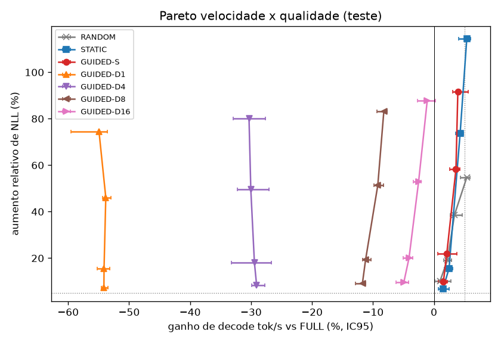

# VETOR — Vector-guided Efficient Transformer Operation Routing

> **Um vetor-guia probabilístico, lido dos estados internos de um token, consegue decidir quais blocos MLP de um Transformer denso pré-treinado podem ser pulados, economizando tempo real de decodificação sem degradar a qualidade?**

**Estado (v0.1): resultado negativo, medido e reproduzível.** No SmolLM2-135M em Apple Silicon (MPS), o guia aprende sinal real, mas **nenhuma política atingiu o critério de sucesso** definido antes do experimento. Os motivos estão diagnosticados, e as próximas hipóteses estão em [docs/MELHORIAS.md](docs/MELHORIAS.md). Críticas e propostas são muito bem-vindas: veja [Como participar](#como-participar).

*English summary:* We route (skip) whole MLP blocks of a frozen dense LLM during decoding, using a tiny learned probe (576→16, ~11k params) over each layer's MLP input. The probe learns real context signal (within-layer AUC 0.72 for the selected probe, up to 0.77 for other variants), but in real autoregressive decoding with joint skips no policy (learned, static, random) keeps NLL increase ≤5%, and speed gains are capped at ~13% because 135M-parameter decoding on PyTorch/MPS is CPU-dispatch-bound. Root causes measured: non-additive layer interactions (up to ~3×) and KV-cache error accumulation (~2×). All code, raw results and the pre-registered protocol are here.

---

## Resultados principais (conjunto de teste, 61 janelas held-out)

Critério definido **antes** de rodar (especificação, seção 6): ≥20% dos MLPs elegíveis omitidos, **ΔNLL ≤ 5%**, ≥5% mais tok/s e superar RANDOM e STATIC no mesmo orçamento.

| MLPs omitidos (de 30) | STATIC | RANDOM | GUIDED-S | GUIDED-D1 | Speedup (STATIC) |
|---|---|---|---|---|---|
| 3 (10%) | **+6,8%** | +10,2% | +9,9% | +7,4% | +1,5% |
| 5 (17%) | **+15,6%** | +19,2% | +22,0% | **+15,6%** | +2,5% |
| 8 (27%) | +73,7% | **+38,6%** | +58,2% | +46,1% | +4,3% |
| 10 (33%) | +114,5% | **+54,8%** | +91,7% | +74,3% | +5,4% |

ΔNLL = aumento relativo da NLL do texto verdadeiro, com teacher forcing e KV cache, política ativa no decode. Tabela completa, com IC95, KL, concordância top-1/greedy, p95 e memória: **[results/REPORT.md](results/REPORT.md)**.



### O que aprendemos

1. **O mecanismo funciona, e funciona exatamente.** Com 100% dos MLPs, o modelo instrumentado é bit a bit igual ao original, e o skip faz *zero* chamadas ao MLP (testado).
2. **O guia aprende contexto, não só o índice da camada.** Dentro da mesma camada, ele separa contextos seguros de inseguros com AUC 0,72 (validação, guia selecionado; outras variantes chegaram a 0,77).
3. **Mas o rótulo do professor não mede o dano real.** Ele rotula *uma* camada, *um* token, com prefixo intacto. No decode real:
   - **interação:** pular camadas vizinhas custa até **~2,9×** a soma dos custos isolados (por isso o STATIC, que pula o bloco 11–18, fica pior que o RANDOM a partir de 8 camadas);
   - **acumulação:** o erro entra no KV cache e **~dobra** ao longo dos tokens ([diagnóstico](results/diag_interaction_val.json)).
4. **Decidir a cada token ajuda a qualidade** (GUIDED-D1 > D4 > D8 > D16 > S, de forma monotônica), **mas custa caro em tempo:** cada decisão exige 1 sincronização GPU→CPU, e o GUIDED-D1 roda a **0,46×** da velocidade do FULL. A versão dinâmica só faz sentido com decisão na própria GPU.
5. **O teto de velocidade é baixo neste modelo.** O decode do SmolLM2-135M em PyTorch/MPS é limitado pela CPU (3,54 de 3,60 ms/token são despacho Python). Cada MLP pulado economiza ~18 µs; pulando todos os 26 elegíveis, o ganho máximo seria ~13%. Os FLOPs evitados quase não importam neste regime ([diagnóstico](results/diag_dispatch.json)).
6. **Achado de engenharia (independente do VETOR):** sem limitar quanto a CPU pode enfileirar à frente da GPU, o decode em MPS fica **~2× mais lento** (146 contra 281 tok/s). Um throttle por eventos MPS resolve e supera o `generate` do HF. Ele foi aplicado igualmente a todas as políticas.

---

## Como reproduzir

Requisitos: Python ≥ 3.11, ~2 GB de disco. Os resultados foram gerados em um Apple M4 Max (macOS 15.7, torch 2.15, transformers 5.24); versões exatas em [requirements-lock.txt](requirements-lock.txt).

```bash
git clone https://github.com/Frbastoseng/Vetor-GETOR.git && cd Vetor-GETOR
python3 -m venv .venv && source .venv/bin/activate
pip install -e ".[dev]"

python -m pytest -q                       # 36 testes (use -m "not model" para pular os que baixam o modelo)
python scripts/00_sanity.py               # ambiente, config do modelo, caminho real do MLP
python scripts/01_baseline.py             # FULL: equivalência com generate, CPU x MPS, tempos
python scripts/02_ablate.py               # professor: KL/ΔNLL por camada (~7 min no M4 Max)
python scripts/03_train.py                # guia; seleção SÓ na validação
python scripts/04_evaluate.py --split val
python scripts/04_evaluate.py --split test   # rodado UMA vez, com decisões congeladas
python scripts/05_benchmark.py --kinds STATIC RANDOM GUIDED-S GUIDED-D --guide results/guide.pt --repeats 20 --tag final_bench
python scripts/06_report.py               # gera results/REPORT.md e gráficos
```

Diagnósticos: `scripts/diag_dispatch.py` (CPU × GPU, teto do skip) e `scripts/diag_interaction.py` (interação × acumulação).
Sem MPS, tudo roda em CPU (`device: cpu` em `configs/default.yaml`, ou `VETOR_DEVICE=cpu` nos testes); os tempos mudam, a lógica não.

## Desenho do experimento

- **Modelo:** `HuggingFaceTB/SmolLM2-135M-Instruct` (Apache-2.0), revisão fixa `12fd25f7`, float32, pesos congelados (hash verificado).
- **Intervenção:** só os blocos `model.model.layers[l].mlp`; atenção, normas e KV sempre completos. O skip retorna zero **sem** chamar o MLP; o prefill nunca é pulado. Camadas 0, 1, 28 e 29 são protegidas.
- **Guia:** `g = tanh(P·LN(z) + e[l])`, `s = wᵀg + b[l]`, com P: 576→16 (10.894 parâmetros). Entrada: só `z[l,t]` (a entrada do MLP) e o índice da camada.
- **Professor:** para cada prefixo, um forward em lote com 31 linhas: a linha 0 é o FULL e a linha l+1 tem o MLP da camada l zerado no último token. Rótulos: KL(p_FULL‖p_l) e ΔNLL.
- **Dados:** WikiText-2 (CC BY-SA 3.0), com os splits oficiais por **artigo**: 3.622 / 240 / 240 prefixos no professor e 60–61 janelas de avaliação (64 + 64 tokens).
- **Políticas:** FULL, RANDOM, STATIC (ranking do treino), ORACLE-DIAG (limite não implementável), GUIDED-S (decide no prefill) e GUIDED-D{1,4,8,16} (reavalia a cada K tokens com z do token anterior: causal). Todas comparadas com **o mesmo número de MLPs omitidos**.
- **Medição de tempo:** prefill e decode separados, sincronização só nas bordas, ordem rotacionada, speedup pareado com IC95 bootstrap.

Os critérios de sucesso foram fixados antes do experimento e estão resumidos acima.

## Estrutura

```
src/vetor/
  model_adapter.py   carga do modelo, ambiente, throttle MPS, hash de pesos
  wrappers.py        RoutedMLP: skip real, ablação diagnóstica, captura de z
  guide.py           vetor-guia e seleção top-k com camadas protegidas
  policies.py        FULL / RANDOM / STATIC / ORACLE-DIAG / GUIDED-S / GUIDED-D
  decode.py          loop greedy / teacher forcing com KV (sem .item() no laço)
  collect.py         dados por artigo e professor de ablação em lote
  train_router.py    treino do guia (regress / quantile / classify) e métricas offline
  evaluate.py        NLL, KL, top-1, greedy com omissões conjuntas reais
  benchmark.py       tempos de prefill/decode, p95, speedup pareado
  report.py          tabela e gráficos de Pareto
scripts/             00–06 (pipeline) + diagnósticos
tests/               gate de qualidade (equivalência, skip real, cache, vazamento, orçamento...)
results/             todos os JSON/CSV/PNG das execuções (ver results/README.md)
docs/MELHORIAS.md    diagnóstico e próximas hipóteses
```

## Como participar

Este é um projeto de pesquisa aberta, e resultados negativos fazem parte dele.

- **Achou um problema no método?** Abra uma issue *Questionamento metodológico*. É a contribuição mais valiosa.
- **Tem uma ideia?** Veja [docs/MELHORIAS.md](docs/MELHORIAS.md) (M1–M8) e abra uma *Proposta de experimento*, com o critério de sucesso definido antes de rodar.
- **Reproduziu em outra máquina?** Os números de tempo em CUDA, CPU ou outros Macs são muito úteis: abra uma issue *Bug / reprodução* com seus resultados.
- Regras para PRs e para manter a validade do experimento: [CONTRIBUTING.md](CONTRIBUTING.md).

## Limitações

- Um único modelo pequeno (135M), em inglês, e uma única plataforma (MPS); os resultados de tempo não se transferem diretamente para GPUs dedicadas ou modelos maiores.
- O critério de "qualidade" é NLL, KL e concordância de tokens em texto da Wikipédia, não avaliação de tarefas.
- O guia v0.1 roteia só MLPs inteiros; os pesos pulados continuam na memória, então **não há economia de RAM**.
