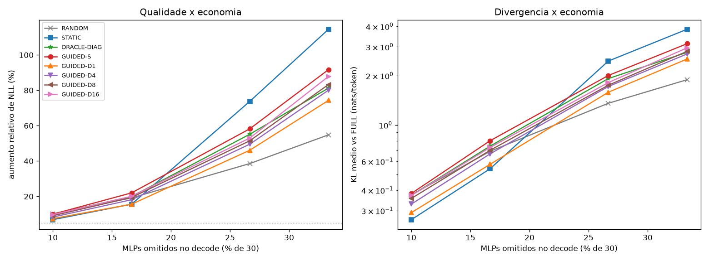
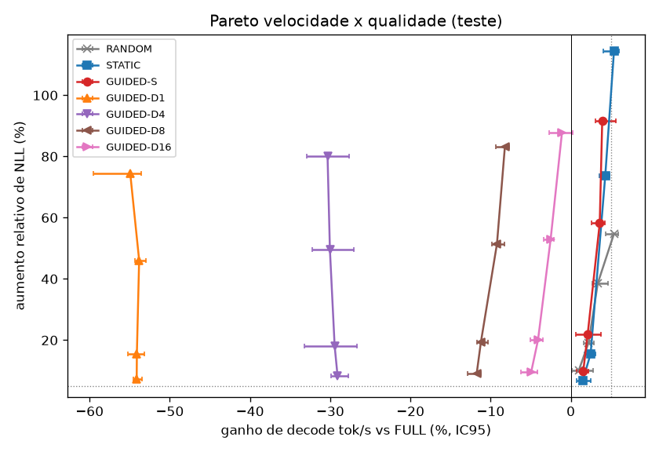
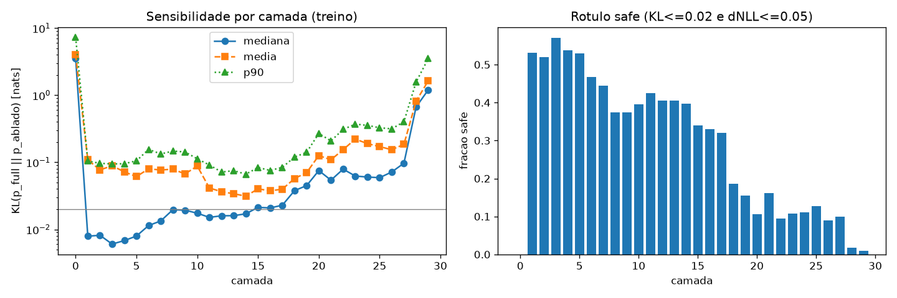

# VETOR — relatório de resultados (gerado automaticamente)

- Avaliação de qualidade: `20261122-180647_eval_test.json` (61 janelas de **teste**, prompt 64 + continuação 64 tokens)
- Benchmark: `20261122-184318_final_bench.json` (20 repetições pareadas, 64 forwards de decode, prompt 64, torch.float32)
- Guia: alvo `quantile:0.1`, semente 0, pool `None` — selecionado na validação
- Ambiente: Apple M4 Max, macOS 15.7.7, torch 2.15.0, transformers 5.24.0, device `mps`

## Baseline FULL

- Equivalência com `generate`: 12/12 sequências idênticas; diferença de logits com wrappers: 0.0
- Decode FULL: **280.9 tok/s** (mediana), prefill 14.0 ms
- Sem throttle de eventos MPS: 145.8 tok/s

## Tabela principal (teste)

Omissões = fração dos 30 MLPs pulados por token de decode. ΔNLL% = aumento relativo da NLL do texto verdadeiro (teacher forcing com KV, política ativa). KL contra FULL no mesmo prefixo. Speedup pareado contra FULL (IC95 bootstrap). ORACLE-DIAG usa informação do próprio exemplo e **não é implementável**: é só um limite superior.

| política | k | omissões | ΔNLL % | IC95 | KL médio | KL p90 | top-1 = | greedy = | tok/s | speedup | IC95 | p95 ms |
|---|---|---|---|---|---|---|---|---|---|---|---|---|
| GUIDED-D1 | 3 | 10.0% | 7.43 | [6.20, 8.81] | 0.2921 | 0.6221 | 0.751 | 0.175 | 121.8 | 0.459 | [0.455, 0.465] | 559.6 |
| GUIDED-D16 | 3 | 10.0% | 9.73 | [8.22, 11.33] | 0.3716 | 0.7917 | 0.719 | 0.174 | 251.4 | 0.951 | [0.938, 0.959] | 260.8 |
| GUIDED-D4 | 3 | 10.0% | 8.32 | [7.03, 9.60] | 0.3290 | 0.6690 | 0.743 | 0.205 | 189.0 | 0.709 | [0.701, 0.723] | 367.3 |
| GUIDED-D8 | 3 | 10.0% | 9.08 | [7.75, 10.41] | 0.3565 | 0.7353 | 0.737 | 0.171 | 232.9 | 0.883 | [0.872, 0.888] | 279.0 |
| GUIDED-S | 3 | 10.0% | 9.94 | [8.24, 11.84] | 0.3823 | 0.8153 | 0.718 | 0.186 | 268.2 | 1.016 | [1.008, 1.022] | 242.4 |
| ORACLE-DIAG | 3 | 10.0% | 9.94 | [8.16, 11.85] | 0.3727 | 0.8270 | 0.711 | 0.151 | — | — | [—, —] | — |
| RANDOM | 3 | 10.0% | 10.20 | [8.97, 11.50] | 0.3748 | 0.7759 | 0.702 | 0.168 | 268.5 | 1.010 | [1.001, 1.028] | 241.8 |
| STATIC | 3 | 10.0% | 6.84 | [5.81, 7.95] | 0.2644 | 0.6054 | 0.728 | 0.175 | 267.7 | 1.015 | [1.007, 1.025] | 243.4 |
| GUIDED-D1 | 5 | 16.7% | 15.59 | [13.68, 17.64] | 0.5762 | 1.2957 | 0.633 | 0.118 | 121.3 | 0.459 | [0.448, 0.468] | 639.3 |
| GUIDED-D16 | 5 | 16.7% | 20.07 | [17.84, 22.46] | 0.7296 | 1.6263 | 0.598 | 0.118 | 253.8 | 0.959 | [0.949, 0.966] | 255.6 |
| GUIDED-D4 | 5 | 16.7% | 18.12 | [16.16, 20.22] | 0.6668 | 1.5274 | 0.624 | 0.129 | 187.2 | 0.706 | [0.668, 0.733] | 377.3 |
| GUIDED-D8 | 5 | 16.7% | 19.43 | [17.33, 21.60] | 0.7012 | 1.5887 | 0.606 | 0.129 | 235.3 | 0.888 | [0.883, 0.896] | 275.9 |
| GUIDED-S | 5 | 16.7% | 22.01 | [19.21, 25.17] | 0.8021 | 1.8040 | 0.589 | 0.120 | 271.0 | 1.021 | [1.006, 1.038] | 243.4 |
| ORACLE-DIAG | 5 | 16.7% | 19.97 | [17.50, 22.49] | 0.7438 | 1.7287 | 0.595 | 0.123 | — | — | [—, —] | — |
| RANDOM | 5 | 16.7% | 19.15 | [17.28, 21.18] | 0.6914 | 1.4643 | 0.600 | 0.097 | 269.9 | 1.022 | [1.016, 1.029] | 240.3 |
| STATIC | 5 | 16.7% | 15.61 | [14.17, 17.31] | 0.5410 | 1.1622 | 0.635 | 0.152 | 271.5 | 1.025 | [1.017, 1.031] | 238.3 |
| GUIDED-D1 | 8 | 26.7% | 46.11 | [42.57, 49.93] | 1.5848 | 3.4097 | 0.417 | 0.068 | 122.9 | 0.462 | [0.457, 0.470] | 572.0 |
| GUIDED-D16 | 8 | 26.7% | 53.02 | [48.38, 58.09] | 1.8152 | 4.0086 | 0.371 | 0.078 | 256.5 | 0.975 | [0.966, 0.979] | 253.0 |
| GUIDED-D4 | 8 | 26.7% | 49.52 | [45.30, 53.80] | 1.7175 | 3.8530 | 0.398 | 0.064 | 183.8 | 0.700 | [0.678, 0.730] | 378.1 |
| GUIDED-D8 | 8 | 26.7% | 51.46 | [46.95, 56.04] | 1.7493 | 3.8672 | 0.391 | 0.083 | 240.5 | 0.908 | [0.901, 0.918] | 270.3 |
| GUIDED-S | 8 | 26.7% | 58.23 | [51.48, 65.55] | 2.0048 | 4.3737 | 0.365 | 0.077 | 273.4 | 1.036 | [1.026, 1.042] | 237.8 |
| ORACLE-DIAG | 8 | 26.7% | 55.16 | [48.63, 62.69] | 1.9203 | 4.2432 | 0.380 | 0.080 | — | — | [—, —] | — |
| RANDOM | 8 | 26.7% | 38.57 | [35.36, 41.87] | 1.3572 | 2.9409 | 0.452 | 0.071 | 274.3 | 1.034 | [1.027, 1.046] | 236.7 |
| STATIC | 8 | 26.7% | 73.74 | [67.99, 80.11] | 2.4558 | 5.0890 | 0.297 | 0.060 | 274.7 | 1.043 | [1.036, 1.049] | 237.7 |
| GUIDED-D1 | 10 | 33.3% | 74.33 | [68.57, 80.00] | 2.5279 | 5.2697 | 0.279 | 0.054 | 120.5 | 0.451 | [0.405, 0.464] | 680.7 |
| GUIDED-D16 | 10 | 33.3% | 87.87 | [80.92, 95.56] | 2.9562 | 6.1918 | 0.251 | 0.049 | 260.5 | 0.989 | [0.973, 1.002] | 249.5 |
| GUIDED-D4 | 10 | 33.3% | 80.10 | [74.64, 86.27] | 2.7141 | 5.6206 | 0.269 | 0.049 | 185.6 | 0.697 | [0.671, 0.724] | 374.4 |
| GUIDED-D8 | 10 | 33.3% | 83.29 | [76.44, 90.91] | 2.8160 | 5.9864 | 0.265 | 0.059 | 242.0 | 0.918 | [0.907, 0.923] | 267.1 |
| GUIDED-S | 10 | 33.3% | 91.72 | [82.66, 101.03] | 3.1343 | 6.4852 | 0.232 | 0.051 | 277.0 | 1.039 | [1.031, 1.056] | 241.0 |
| ORACLE-DIAG | 10 | 33.3% | 81.29 | [73.84, 89.17] | 2.7755 | 5.8782 | 0.262 | 0.060 | — | — | [—, —] | — |
| RANDOM | 10 | 33.3% | 54.83 | [50.57, 59.19] | 1.8901 | 3.9549 | 0.372 | 0.065 | 278.2 | 1.054 | [1.044, 1.060] | 233.3 |
| STATIC | 10 | 33.3% | 114.53 | [106.46, 123.24] | 3.8398 | 7.2665 | 0.180 | 0.048 | 278.3 | 1.054 | [1.041, 1.060] | 233.9 |

## GUIDED contra controles no mesmo orçamento (ΔNLL %, teste)

|   k |   GUIDED-D1 |   GUIDED-D16 |   GUIDED-D4 |   GUIDED-D8 |   GUIDED-S |   ORACLE-DIAG |   RANDOM |   STATIC |
|----:|------------:|-------------:|------------:|------------:|-----------:|--------------:|---------:|---------:|
|   3 |        7.43 |         9.73 |        8.32 |        9.08 |       9.94 |          9.94 |    10.20 |     6.84 |
|   5 |       15.59 |        20.07 |       18.12 |       19.43 |      22.01 |         19.97 |    19.15 |    15.61 |
|   8 |       46.11 |        53.02 |       49.52 |       51.46 |      58.23 |         55.16 |    38.57 |    73.74 |
|  10 |       74.33 |        87.87 |       80.10 |       83.29 |      91.72 |         81.29 |    54.83 |   114.53 |

Custo do guia: 10894 parâmetros, ~552,960 FLOPs por decisão; 224 µs por decisão (mediana, com sincronização).

## Diagnóstico de despacho (por que o ganho de tempo é pequeno)

- FULL: 3.60 ms/token, dos quais 3.54 ms são CPU enfileirando (decode limitado pela CPU).
- Teto prático (26 MLPs elegíveis pulados): 3.12 ms/token (−13.3%).
- Economia medida por MLP pulado: 18.5 µs.

## Seleção do guia (validação)

Critério STATIC (val): 0.2997

| alvo | pool | critério médio (3 sementes) |
|---|---|---|
| quantile:0.1 | None | 0.2679 |
| quantile:0.25 | None | 0.2693 |
| quantile:0.1 | 4 | 0.2767 |
| quantile:0.1 | 2 | 0.2791 |
| quantile:0.1 | 6 | 0.2822 |
| quantile:0.25 | 6 | 0.2826 |
| quantile:0.25 | 4 | 0.2853 |
| quantile:0.25 | 2 | 0.2874 |
| regress | 2 | 0.2948 |
| regress | 4 | 0.3000 |
| classify | 2 | 0.3027 |
| regress | None | 0.3036 |
| regress | 6 | 0.3084 |
| classify | 4 | 0.3096 |
| classify | 6 | 0.3274 |
| classify | None | 0.3515 |

## Gráficos

