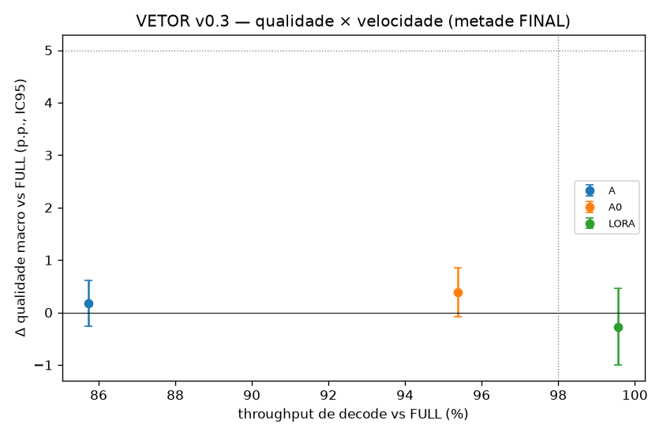

# VETOR v0.3 — Relatório de resultados (gerado automaticamente)

- **Avaliação final única** na metade FINAL das 10 tarefas aplicáveis. A decisão foi congelada no commit `d774efcaab` (2026-11-23T18:24:44-03:00), antes de o conjunto final ser lido.
- **VETOR principal** (escolhido na DEV): `A`, a correção residual com portão do vetor-guia. As configurações com 2 sementes têm o escore de cada exemplo calculado como a média das duas.
- **IC95:** bootstrap pareado, com 10.000 reamostragens por tarefa.

## 1. Critérios pré-registrados (metade FINAL)

| Critério | Meta | Resultado | Atingido? |
|---|---|---|---|
| Q1 qualidade | VETOR − FULL ≥ +5,0 p.p., IC95 > 0 | +0.17 p.p. [-0.26, +0.61] | não |
| Q2 sem regressão grave | nenhuma categoria ≤ −2,0 p.p. | pior: instrucoes -2.09 p.p. | não |
| Q3 superior aos controles | VETOR − melhor controle (A0) > 0, IC95 > 0 | -0.21 [-0.57, +0.14] | não |
| S1 ganho atribuível ao guia | VETOR − A₀ > 0 **e** VETOR − LoRA > 0 (IC95) | A₀: -0.21 [-0.57, +0.14] · LoRA: +0.44 [-0.22, +1.12] | não |
| P1 throughput | ≥ 98% do FULL | 85.7% [84.9, 86.1] | não |
| P2 TTFT | ≤ +5% | -12.9% ⚠️ | sim, com ressalva¹ |
| P3 memória | ≤ +5% | 84,248 parâmetros = 0.34 MB (< 0,1% do modelo)² | sim² |
| P4 zero sincronizações por camada | teste automático | `tests/test_v3_modules.py::test_gate_has_no_host_sync` | **sim** |

¹ O TTFT medido saiu **menor** com os módulos do que no FULL, o que não tem explicação física: os módulos só acrescentam operações. É provável artefato de aquecimento após a troca de configuração na medição. O critério é considerado atendido apenas porque os módulos acrescentam uma fração ínfima de operações ao prefill, e não por causa desse número.

² A memória alocada pelo driver MPS não tem resolução para diferenças desse tamanho (a medida deu −0,0%). Por isso, o critério foi avaliado pelo tamanho dos parâmetros adicionados.

## 2. Qualidade na metade FINAL (diferença vs FULL, p.p., IC95)

FULL: média macro = **34.96**

| Modelo | Macro | Δ vs FULL | IC95 |
|---|---|---|---|
| VETOR A: correção + portão do guia (2 sementes) | 35.13 | **+0.17** | [-0.26, +0.61] |
| A₀: correção estática, sem guia (2 sementes) | 35.34 | **+0.38** | [-0.08, +0.86] |
| LoRA, mesmos dados e perda (2 sementes) | 34.69 | **-0.27** | [-1.00, +0.47] |

**Por tarefa (Δ vs FULL, p.p.):**

| Tarefa | Categoria | FULL | A | A0 | LORA |
|---|---|---|---|---|---|
| arc_challenge | raciocinio | 26.42 | +0.94 | +0.69 | -0.09 |
| hellaswag | raciocinio | 43.17 | +0.03 | +0.07 | -1.06 |
| piqa | raciocinio | 67.70 | -0.05 | -0.31 | +0.05 |
| arc_easy | conhecimento | 46.62 | +1.52 | +2.97 | +2.43 |
| openbookqa | conhecimento | 31.02 | -0.41 | -0.20 | -0.82 |
| sciq | conhecimento | 76.17 | +0.59 | -0.10 | -3.42 |
| arithmetic_2dm | matematica | 4.24 | +0.39 | +1.09 | -2.52 |
| ifeval | instrucoes | 22.05 | -2.09 | -0.95 | -0.76 |
| mbpp | programacao | 2.78 | +0.60 | +0.60 | +2.98 |
| hellaswag_pt | portugues | 29.43 | +0.20 | -0.03 | +0.51 |

**Comparações diretas (pareadas):**

| Comparação | Δ (p.p.) | IC95 | O que isola |
|---|---|---|---|
| A − A0 | -0.21 | [-0.57, +0.14] | valor do portão adaptativo (S1) |
| A − LORA | +0.44 | [-0.22, +1.12] | VETOR vs adapter convencional (S1) |
| A0 − LORA | +0.65 | [-0.01, +1.32] | correção residual vs LoRA |

## 3. Desempenho real (decode de 63 tokens, prompt 64, float32, MPS; LoRA fundido)

| Modelo | tok/s | Throughput vs FULL [IC95] | TTFT (ms)¹ | Memória do driver vs FULL² |
|---|---|---|---|---|
| FULL | 292 | 100.0% [100.0, 100.0] | 13.6 | +0.0% |
| A0 | 277 | 95.4% [93.9, 97.5] | 11.3 | -0.0% |
| A | 248 | 85.7% [84.9, 86.1] | 11.9 | -0.0% |
| C | 231 | 79.8% [79.0, 80.1] | 12.1 | -0.0% |
| B | 255 | 87.6% [86.6, 88.6] | 11.8 | -0.0% |
| B0 | 285 | 97.7% [96.8, 98.6] | 11.4 | -0.0% |
| LORA | 289 | 99.6% [97.0, 100.7] | 13.7 | -0.0% |

Parâmetros treináveis: A0 73,728; A 84,248; C 84,272; B 75,015; LORA 97,920 (o LoRA, depois de fundido, tem 0 parâmetros extras na inferência).

## 4. Todas as configurações testadas na DEV (desenvolvimento)

Os modelos não avaliados na FINAL (C, B, B₀, LoRA+destilação e v0.2) aparecem **só aqui, com resultados da DEV**. Ver a seção 9 de `PLANO_EXPERIMENTAL_V0.3.md`.

**Comparações diretas na DEV (semente 0, pareadas):**

| Comparação | Δ (p.p.) | IC95 |
|---|---|---|
| A_r8_task_g1 − A0_r8_task_g1 | -0.10 | [-0.56, +0.34] |
| B_r8_rep4_task_g1 − B0_r8_rep4_task_g1 | +0.11 | [-0.06, +0.29] |
| C_r8_task_g1 − A0_r8_task_g1 | -0.21 | [-0.62, +0.18] |
| A0_r8_task_g1 − LORA_r1_task_g1_lr1e3 | +0.91 | [+0.09, +1.74] |

| Execução | Parâmetros | Δ vs FULL (DEV) | IC95 |
|---|---|---|---|
| A0_r16_task | 147,456 | -0.10 | [-0.69, +0.51] |
| A0_r8_kd | 73,728 | -0.01 | [-0.60, +0.58] |
| A0_r8_kd_g1 | 73,728 | +0.01 | [-0.52, +0.54] |
| A0_r8_task | 73,728 | +0.60 | [-0.01, +1.21] |
| A0_r8_task_g1 | 73,728 | +0.59 | [+0.03, +1.15] |
| A0_r8_task_g1_s1 | 73,728 | +0.22 | [-0.35, +0.79] |
| A_r8_kd_g1 | 84,272 | -0.18 | [-0.69, +0.34] |
| A_r8_task_g1 | 84,248 | +0.49 | [-0.04, +1.02] |
| A_r8_task_g1_s1 | 84,272 | +0.12 | [-0.45, +0.68] |
| B0_r8_rep4_task_g1 | 64,512 | -3.17 | [-4.03, -2.35] |
| B_r8_rep4_task_g1 | 75,015 | -3.06 | [-3.90, -2.25] |
| C_r8_task_g1 | 84,272 | +0.38 | [-0.13, +0.90] |
| LORA_r1_kd | 97,920 | -3.25 | [-4.26, -2.22] |
| LORA_r1_kd_g1_lr1e3 | 97,920 | +0.04 | [-0.75, +0.85] |
| LORA_r1_task_g1_lr1e3 | 97,920 | -0.32 | [-1.13, +0.50] |
| LORA_r1_task_g1_lr1e3_s1 | 97,920 | -0.70 | [-1.55, +0.12] |
| LORA_r1_task_lr1e3 | 97,920 | -0.20 | [-1.02, +0.63] |
